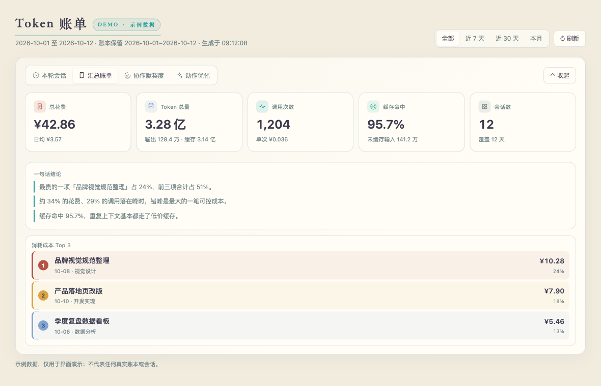
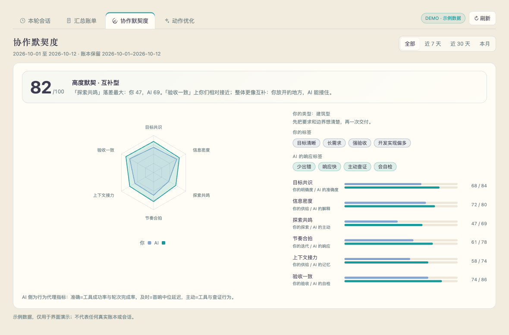
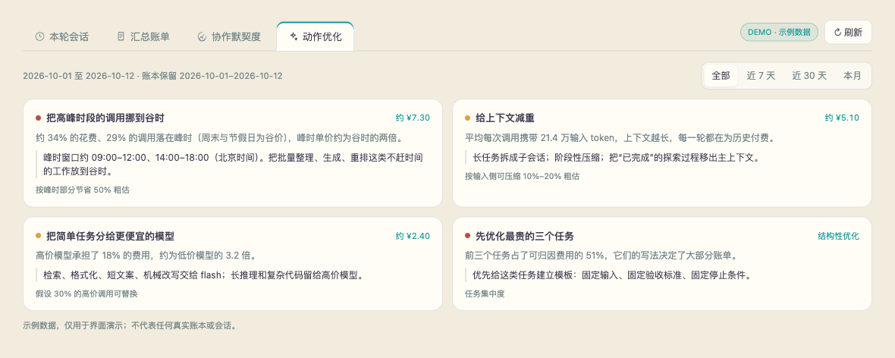

# dsh-token-bill

[English](README.md) | [简体中文](README.zh-CN.md) | **日本語** | [한국어](README.ko.md)

バージョン **0.1.6**（2026-11-25）· パッケージ `@zhiyu.pub/dsh-token-bill`。

ローカルのコスト台帳とセッションログを、読める「Token 明細」に変える [DeepSeek Harness](https://github.com/deepseek-ai/deepseek-harness)（DSH）バンドルです。会話ページに **明細（账单）** ビューを追加します。

## インストール

```sh
dsh plugin --profile desktop add @zhiyu.pub/dsh-token-bill
```

web プロファイルでは `desktop` を `web` に。ソースからは `dsh plugin --profile desktop add github:renzg/dsh-token-bill` でもインストールできます。ローカルの `dsh-cost-meter` 台帳とセッションログのみを読み、API キーは不要です。

## レポート出力

**更新** の隣の「レポート生成」から形式を選べます：

- **HTML** — 単体で開ける可視化レポート
- **PDF** — 印刷向けの可視化レポート（ローカルの Chrome/Edge で描画）
- **DOCX** — 表とカラーバー付きの Word レポート
- **JSON** — 生のレポートデータ

すべてローカルで生成され、外部送信はありません。

## デモ

以下はすべてサンプルデータで、実際の台帳やセッションではありません。画面は中国語 UI です。

### 集計明細



### 協働の相性



### アクション最適化



## 機能モジュール

### 上部タブ

ページタイトルの代わりに 4 つのトップタブを置きます：`今回のセッション` / `集計明細` / `協働の相性` / `アクション最適化`。それぞれ独立したモジュールです。期間切替（すべて / 過去7日 / 過去30日 / 今月）は集計明細・協働の相性・アクション最適化の内部にあります。

- **今回のセッション**：現在のセッションの費用、費用タイプ構成（割合 / 矩形分布 / 親子帰属 / ステップヒートマップ）、ターン数、折りたたみ式のコスト推移。セッション固有のため期間切替はありません。内部は「概要 / 詳細」に分かれ、詳細では Token 構成、ツール Top、ステップ別費用を表示します。
- **集計明細**：内部は「概要 / 詳細 / タスク関連」の3つ。概要は KPI・1行の結論・コスト上位3タスク（赤 / 金 / 青の目印）、詳細は期間分布・タスク明細・ツール・モデル分布・タスク種別、タスク関連は関係図のみです。
- **協働の相性**：6軸のデュアルレーダー、双方のタグ、相性スコア、補完 / 同調の判定、軸ごとの差。
- **アクション最適化**：ピーク回避、キャッシュ、文脈、モデル振り分け、タスク集中、ツールループの提案。根拠と概算削減額を添えます。

### 期間分布

月 / 週 / 日 / 時。日別の棒グラフには金額軸と3日間のトレンド曲線があり、時間別は「曜日 × 時間」のヒートマップです。ホバーで金額、クリックで詳細が見られます。

### タスク明細

セッション単位の帰属をカードまたは表で表示。カードには Token 構成リング、1ターンあたり費用、初回応答の中央値、ツールエラー率、よく使うツールが並びます。検索、費用 / Token 順の並べ替え、タスク種別での絞り込みに対応。表の行をクリックすると詳細が開きます。

### ツールと実行

呼び出し回数上位12ツール、中央値 / P90 の実行時間、エラー率、利用タスク数。ツールをクリックするとタスクを絞り込めます。

### タスク関連図

証拠のある関係だけを線で結びます — 共通の記憶トピック、成果物ファイルの再利用、明示的な参照、親子セッション。同一ワークスペース / 同日 / 同種別だけでは線を引きません。証拠のないタスクは孤立点のままです。曲線エッジ、力指向レイアウト、ホバーで隣接ノードを強調、ノードはドラッグ可能、エッジの理由はホバーで表示。

### モデル分布

既定はリスト。「グラフ」に切り替えると、チャネル → モデルの費用割合をサンバーストで表示。リストの行をクリックすると100万 Token あたりと1回あたりの費用が見られます。

### タスク種別

既定はリスト。「グラフ」に切り替えると、種別 → タスクの費用割合をサンバーストで表示。種別をクリックするとタスクを絞り込めます。

## データの出所

- 費用と Token：ローカルの `dsh-cost-meter` 台帳 `~/.dsh/storages/cost-meter/ledger.json`。
- 時間別分布、ターン、ツール呼び出し、ユーザーのプロンプト：`~/.dsh/sessions/` のセッションログ。
- アップロードもネットワーク通信も行いません。バンドルを無効にするとビューは消えますが、台帳は変わりません。

## 制約

- 台帳にはコストプラグイン導入後の記録だけが残ります。それ以前の日付は空です。保持範囲はページに表示されます。
- 時間別金額は按分値であり、呼び出しごとの請求ではありません。ピーク／オフピークの重みはコストプラグインの設定に従い、合計は日別台帳と一致します。
- スタイル画像には選択期間内に少なくとも1件のユーザーメッセージが必要です。AI 側の指標はツール結果、ターン完了、初回応答遅延、ツールの種類、訂正表現から作る行動の代理指標で、意味的な正解率ではありません。
- 削減額は保守的な概算で、複数の提案は重複する可能性があります。合計は単純加算できません。
