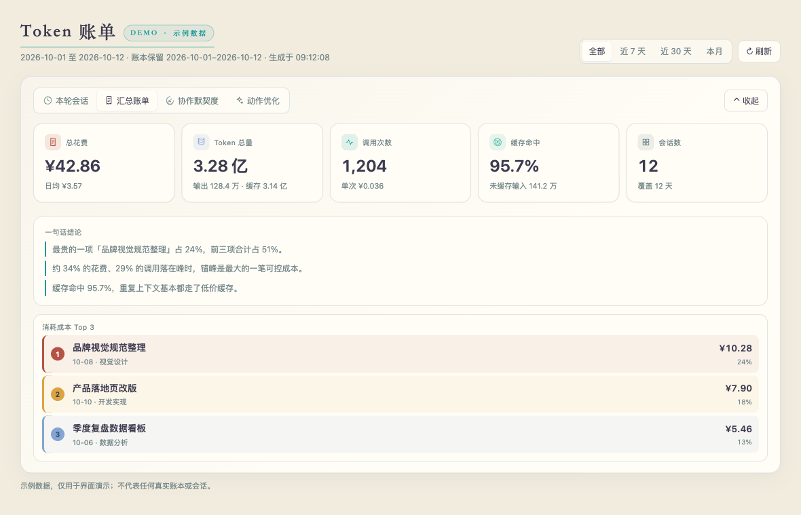
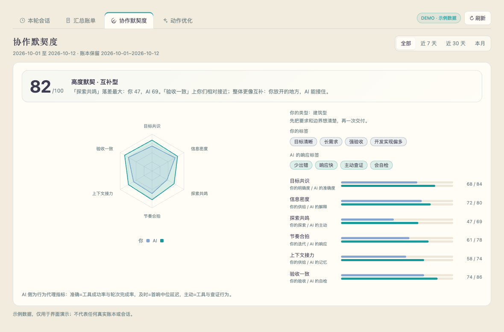
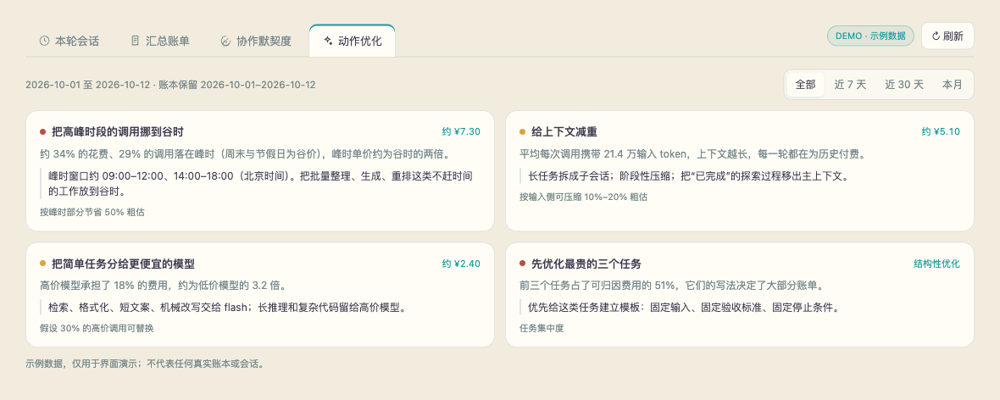

# dsh-token-bill

[English](README.md) | [简体中文](README.zh-CN.md) | [日本語](README.ja.md) | **한국어**

버전 **0.1.10** (2026-11-25) · 패키지 `@zhiyu.pub/dsh-token-bill`.

로컬 비용 원장과 세션 로그를 읽기 쉬운 **Token 명세**로 바꾸는 [DeepSeek Harness](https://github.com/deepseek-ai/deepseek-harness)(DSH) 번들입니다. 대화 페이지에 **명세(账单)** 뷰를 추가합니다.

## 설치

```sh
dsh plugin --profile desktop add @zhiyu.pub/dsh-token-bill
```

웹 프로필에서는 `desktop`을 `web`으로 바꾸세요. 소스에서는 `dsh plugin --profile desktop add github:renzg/dsh-token-bill`로 설치할 수 있습니다. 로컬 `dsh-cost-meter` 원장과 세션 로그만 읽으며 API 키가 필요 없습니다.

## 보고서 내보내기

새로고침 뒤에 GitHub 저장소 링크가 있습니다. 저장소 star가 100을 넘으면 star 수가 함께 표시됩니다.

새로고침 옆의 **보고서 생성**에서 형식을 선택합니다:

- **HTML** — 단일 파일 시각화 보고서
- **PDF** — 인쇄용 시각화 보고서(로컬 Chrome/Edge로 렌더링)
- **DOCX** — 표와 컬러 막대가 있는 Word 보고서
- **JSON** — 원본 보고서 데이터

모든 형식은 로컬에서 생성되며 외부로 전송되지 않습니다.

## 데모

아래는 모두 샘플 데이터이며 실제 원장이나 세션이 아닙니다. 화면은 중국어 UI입니다.

### 요약 명세



### 협업 궁합



### 액션 최적화



## 기능 모듈

### 상단 탭

페이지 제목 대신 네 개의 1차 탭을 둡니다: `이번 세션` / `요약 명세` / `협업 궁합` / `액션 최적화`. 각각 독립된 모듈입니다. 모듈 제목에는 현재 하위 뷰를 표시하고, 전환 탭과 기간은 오른쪽에 둡니다. 기간 전환(전체 / 최근 7일 / 최근 30일 / 이번 달)은 요약 명세·협업 궁합·액션 최적화 내부에 있습니다.

- **이번 세션**: 현재 세션의 비용, 비용 유형 구성(비중 / 사각형 분포 / 부모-자식 귀속 / 단계 히트맵), 턴 수, 접힌 비용 추이. 세션 전용이라 기간 전환이 없습니다. 내부는 **개요 / 상세**로 나뉘며, 상세에는 Token 구성, 도구 Top, 단계별 비용이 있습니다.
- **요약 명세**: 내부는 **개요 / 상세 / 작업 관계도** 세 탭입니다. 개요는 KPI·한 줄 결론·전체 기간 비용 유형 구성·비용 상위 5개 작업, 상세는 기간 분포·작업 명세·도구·모델 분포·작업 유형, 작업 관계도는 관계도만 표시합니다.
- **협업 궁합**: 6축 듀얼 레이더, 양쪽 태그, 궁합 점수, 보완 / 동조 판단, 축별 차이.
- **액션 최적화**: 피크 회피, 캐시, 맥락, 모델 분배, 작업 집중, 도구 루프 제안. 근거와 대략적인 절감액을 붙입니다.

### 기간 분포

월 / 주 / 일 / 시. 일별 막대에는 비용 축과 3일 추세 곡선이 있고, 시간별은 요일 × 시간 히트맵입니다. 마우스를 올리면 금액, 클릭하면 상세가 보입니다.

### 작업 명세

세션별 귀속을 카드 또는 표로 표시. 카드에는 Token 구성 링, 턴당 비용, 첫 응답 중앙값, 도구 오류율, 자주 쓰는 도구가 있습니다. 검색, 비용 / Token 정렬, 작업 유형 필터를 지원하며 표의 행을 클릭하면 상세가 열립니다.

### 도구와 실행

호출 수 상위 12개 도구, 중앙값 / P90 실행 시간, 오류율, 사용한 작업 수. 도구를 클릭하면 작업을 필터링합니다.

### 작업 관계도

증거가 있는 관계만 연결합니다 — 공통 기억 주제, 산출물 파일 재사용, 명시적 참조, 부모/자식 세션. 같은 워크스페이스 / 같은 날짜 / 같은 유형만으로는 연결하지 않습니다. 증거가 없는 작업은 고립된 점으로 남습니다. 곡선 엣지, 힘 기반 레이아웃, 호버 시 인접 노드 강조, 노드 드래그, 엣지 사유 호버 표시.

### 모델 분포

기본은 목록. **그래프**로 전환하면 채널 → 모델 비용 비중을 선버스트로 보여줍니다. 목록 행을 클릭하면 백만 Token당 및 호출당 비용이 보입니다.

### 작업 유형

기본은 목록. **그래프**로 전환하면 유형 → 작업 비용 비중을 선버스트로 보여줍니다. 유형을 클릭하면 작업을 필터링합니다.

## 데이터 출처

- 비용과 Token: 로컬 `dsh-cost-meter` 원장 `~/.dsh/storages/cost-meter/ledger.json`.
- 시간별 분포, 턴, 도구 호출, 사용자 프롬프트: `~/.dsh/sessions/`의 세션 로그.
- 업로드나 네트워크 요청이 없습니다. 번들을 끄면 뷰가 사라지고 원장은 그대로입니다.

## 제약

- 원장에는 비용 플러그인 설치 이후 기록만 남습니다. 그 이전 날짜는 비어 있습니다. 보존 범위는 페이지에 표시됩니다.
- 시간별 금액은 배분값이며 호출별 청구가 아닙니다. 피크 / 비피크 가중치는 비용 플러그인 설정을 따르고 합계는 일별 원장과 일치합니다.
- 스타일 프로필은 선택 기간에 사용자 메시지가 최소 1개 필요합니다. AI 쪽 지표는 도구 결과, 턴 완료, 첫 응답 지연, 도구 종류, 수정 표현에서 만든 행동 대리 지표이며 의미적 정답률이 아닙니다.
- 절감액은 보수적인 추정이며 여러 제안이 겹칠 수 있습니다. 합계는 단순 합산이 아닙니다.
