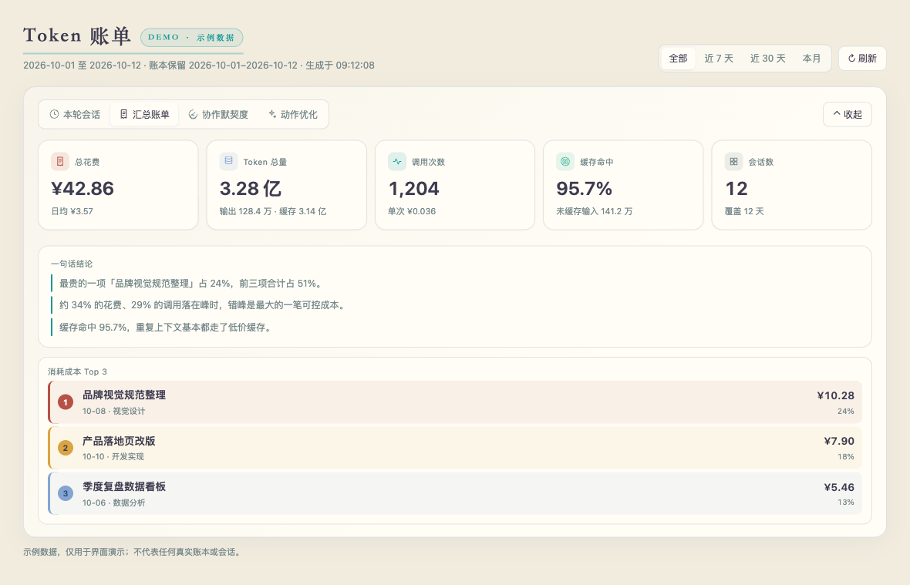
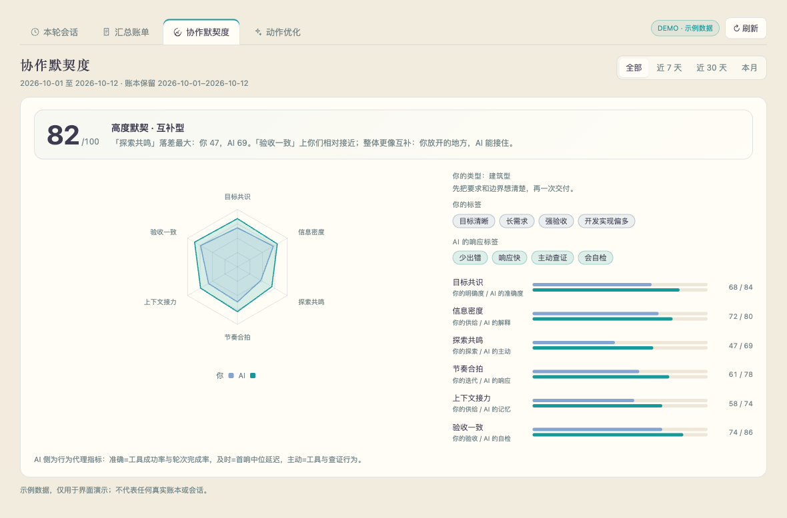
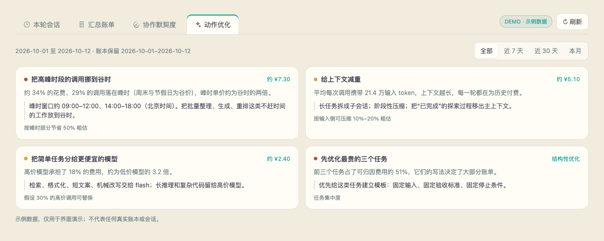

# dsh-token-bill

**English** | [简体中文](README.zh-CN.md) | [日本語](README.ja.md) | [한국어](README.ko.md)

Version **0.1.9** (2026-11-25) · package `@zhiyu.pub/dsh-token-bill`.

A [DeepSeek Harness](https://github.com/deepseek-ai/deepseek-harness) (DSH) bundle that turns the local cost ledger and session logs into a readable token bill. It adds a **Bill (账单)** view to the conversation page.

## Install

```sh
dsh plugin --profile desktop add @zhiyu.pub/dsh-token-bill
```

Use `--profile web` for a web profile. Install from source instead with `dsh plugin --profile desktop add github:renzg/dsh-token-bill`. The bundle reads the local `dsh-cost-meter` ledger and session logs only; no API key is needed.

## Reports

After **Refresh** there is a link to the GitHub repository; when the repo has more than 100 stars, its star count is shown next to it.

Next to **Refresh**, **Generate report** opens a format menu:

- **HTML** — one self-contained visual report page
- **PDF** — print-ready visual report (uses local Chrome/Edge as the renderer)
- **DOCX** — formatted Word report with tables and colored bars
- **JSON** — the raw report data

All formats are generated locally from the current ledger and session logs; nothing is uploaded.

## Demo

Sample data only — not a real ledger or session. Screenshots show the Chinese UI.

### Summary bill



### Collaboration fit



### Action tuning



## Modules

### Top tabs

Four first-level tabs replace the page title: `This session` / `Summary bill` / `Collaboration fit` / `Action tuning`. Each is an independent module. The module title shows the active sub-view; the switch and period controls sit on the right. The period switch (All / 7 days / 30 days / This month) sits inside Summary bill, Collaboration fit and Action tuning.

- **This session**: current session cost, cost-type composition (share / rectangles / parent-child / step heatmap), turns, and a collapsed cost timeline. Session-specific, so it has no period switch; inside, **Overview / Detail** switches to Token breakdown, top tools and per-step costs.
- **Summary bill**: **Overview / Detail / Relations** sub-tabs. Overview is KPIs, a one-line conclusion and the top 3 costliest tasks (red / gold / blue markers); Detail is time, task bill, tools, models and task types; Relations is the task graph alone.
- **Collaboration fit**: dual six-axis radar, tags for both sides, fit score, complement / same-frequency judgement and per-axis gaps.
- **Action tuning**: off-peak, cache, context, model routing, task focus and tool-loop suggestions, each with evidence and a rough saving estimate.

### Time distribution

Month / week / day / hour. The daily chart has a cost axis and a 3-day trend curve; the hourly view is a weekday × hour heatmap. Hover for amounts, click for details.

### Task bill

Attribution by session, in card or table view. Cards show a token-composition ring, cost per turn, median first response, tool error rate and top tools; search, sort by cost or tokens, filter by task type; table rows expand full details.

### Tools & execution

Top 12 tools by calls, median / P90 duration, error rate and task coverage; click a tool to filter tasks.

### Task relationship graph

Only evidenced links: shared memory topics, reused deliverable files, explicit references, parent/child sessions. Same workspace, same day or same task type alone does not connect; tasks without evidence stay isolated. Curved edges, force layout, neighbour focus on hover, draggable nodes, edge reasons on hover.

### Model distribution

List by default; switch to **Chart** for a channel → model cost sunburst. Click a list row for per-million-token and per-call cost.

### Task types

List by default; switch to **Chart** for a type → task sunburst. Click a type to filter tasks.

## Where the data comes from

- Cost and tokens: the local `dsh-cost-meter` ledger at `~/.dsh/storages/cost-meter/ledger.json`.
- Hourly distribution, turns, tool calls and user prompts: local session logs under `~/.dsh/sessions/`.
- Nothing is uploaded and no network request is made. Disabling the bundle removes the view; the ledger is untouched.

## Boundaries

- The ledger only keeps records after the cost plugin was installed; earlier dates are empty. The retained range is shown in the page.
- Hourly amounts are allocated, not per-call billing; peak/off-peak weights follow the cost plugin's configuration and the total still matches the daily ledger.
- The style profile needs at least one user message in the selected range. AI-side metrics come from tool results, turn completion, first-response latency, tool variety and correction phrases; they are behavioural proxies, not semantic accuracy.
- Saving estimates are conservative and may overlap; the sum is not additive.
