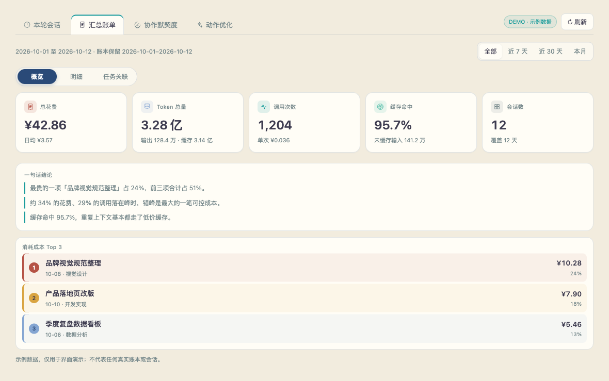
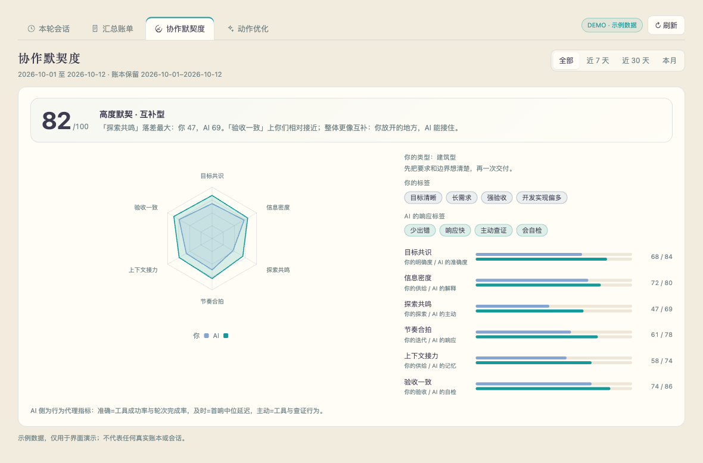
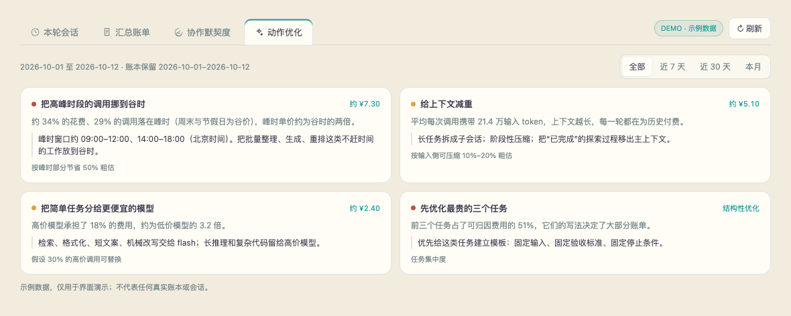

# Token 账单

[English](README.md) | **简体中文** | [日本語](README.ja.md) | [한국어](README.ko.md)

版本 **0.1.5**（2026-11-25）· 包名 `@zhiyu.pub/dsh-token-bill`。

在对话页的视图标签里新增「Token 账单」，把散落在账本与会话日志里的用量整理成一张能读懂的账单。

## 安装

```sh
dsh plugin --profile desktop add @zhiyu.pub/dsh-token-bill
```

web profile 把 `desktop` 换成 `web`。也可以从源码安装：`dsh plugin --profile desktop add github:renzg/dsh-token-bill`。插件只读本机 `dsh-cost-meter` 账本与会话日志，不需要 API Key。

## 报告导出

刷新按钮旁边的「生成报告」可以选格式：

- **HTML** — 单文件可视化网页报告
- **PDF** — 可直接打印/分享的可视化报告（调用本机 Chrome/Edge 渲染）
- **DOCX** — 带表格和彩色柱条的 Word 报告
- **JSON** — 原始账单数据

所有格式都在本机生成，不上传任何数据。

## 演示

以下均为示例数据，不代表任何真实账本或会话。

### 汇总账单



### 协作默契度



### 动作优化



## 功能模块

### 顶部一级标签

四个一级标签替换页面标题：`本轮会话` / `汇总账单` / `协作默契度` / `动作优化`，每个都是独立模块。账期切换（全部 / 近 7 天 / 近 30 天 / 本月）放在汇总账单、协作默契度、动作优化三个模块内部。

- **本轮会话**：当前会话费用、费用类型构成（归类占比 / 矩形分布 / 父子归属 / 步骤热力图）、轮次，以及默认折叠的费用走势。只针对当前会话，所以没有账期切换；内部再分「概览 / 明细」两个胶囊，明细含 Token 构成、工具 Top 和逐步骤费用。
- **汇总账单**：内部再分「概览 / 明细 / 任务关联」三个胶囊。概览是 KPI、一句话结论和消耗成本 Top 3（红 / 金 / 蓝标识）；明细是时间分布、任务账单、工具与执行、模型分布、任务类型；任务关联只保留关系图。
- **协作默契度**：六维双雷达、双方标签、默契分、互补 / 同频判断与逐维落差。
- **动作优化**：错峰、缓存、上下文减重、模型分流、任务聚焦、工具循环等建议，带数据依据和粗略可省金额。

### 时间分布

月 / 周 / 日 / 时四种粒度。日柱状图带纵轴金额刻度和 3 日趋势曲线；时视图是「星期 × 小时」热力图。悬停看金额，点击看该时段明细。

### 任务账单

按会话归因，卡片 / 表格两种视图。卡片带 Token 构成环、单轮费用、首响中位、工具错误率和常用工具；支持搜索、按费用 / Token 排序、按任务类型筛选；表格行可展开完整细节。

### 工具与执行

Top 12 工具调用次数、单次中位 / P90 耗时、错误率与覆盖任务数；点击工具可反向筛选任务。

### 任务关联图

只保留可证实的关系：记忆主题、产出文件复用、明确引用、父子会话。同工作区 / 同日 / 同类型不再自动连边；没有证据的任务保持孤点。曲线边、力导向布局、悬停聚焦相邻节点、可拖拽、边悬停显示原因。

### 模型分布

默认列表，可切「图表」看「渠道 → 模型」的费用占比；列表点击一行看每百万 token 与单次成本。

### 任务类型

默认列表，可切「图表」看「类型 → 任务」的费用占比；点击类型可筛选任务。

## 数据从哪来

- 费用与 token：本机 `dsh-cost-meter` 账本（`~/.dsh/storages/cost-meter/ledger.json`）。
- 小时分布、轮次、工具调用、用户提问：本机会话日志（`~/.dsh/sessions/`）。
- 不上传任何数据，不发网络请求；账本与会话日志都只在本机读取。关闭插件后视图消失，账本不受影响。

## 边界

- 账本只保留安装费用插件之后的记录；更早的日期显示为空。页面会标注账本保留范围。
- 小时金额是分摊值，不是逐次计费；峰谷权重按费用插件配置估算，合计与每日账本一致。
- 提问画像需要所选账期内至少有一条用户消息；样本不足时只给可计算的指标。AI 侧指标来自工具结果、轮次完成、首响延迟、工具种类与纠正用语，是行为代理，不等于语义正确率。
- 建议里的金额是保守粗估，多项建议可能重叠，合计不代表可以叠加。
